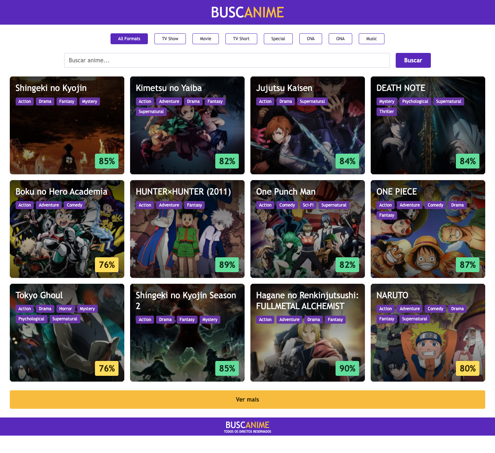

# BUSCANIME

Anime catalog built for the [Winnin frontend challenge](https://github.com/winnin/desafio/blob/master/FRONTEND.md), using React, TypeScript and the public AniList GraphQL API.

Search by text, combine format filters and append results with **Ver mais**. Cards include covers, titles, genres and scores: below 50 red, 50–80 yellow, above 80 green. Missing scores are neutral.

## Run with Docker

Install Docker with Compose, then run:

```sh
docker compose up --build -d
```

Open [localhost:8080](http://localhost:8080). If that host port is occupied, run `PORT=18080 docker compose up --build -d` and open [localhost:18080](http://localhost:18080). The multi-stage image serves production assets with unprivileged Nginx, a healthcheck and a read-only filesystem. The first build needs access to npm and Docker Hub. No API key or environment variables are required; the browser needs internet access to AniList and its image CDN.

```sh
docker compose ps
docker compose logs buscanime
docker compose down
```

## Local development

Use **Node.js 22.20+** and npm:

```sh
npm ci
npm run dev
```

Open the URL printed by Vite. Production preview: `npm run build`, then `npm run preview`.

## Quality checks

```sh
npm run check
npm run format:check
npx playwright install chromium
npm run test:e2e
```

`check` runs ESLint, TypeScript, Vitest and the production build. Individual commands: `npm run lint`, `npm run typecheck`, `npm test`, `npm run build`. `npm run test:watch` starts watch mode; `npm run format` formats files.

Unit/integration tests use Vitest, Testing Library and MSW. Browser journeys use Playwright with deterministic API responses; viewport captures and failure traces are written to `test-results/`. Local alternative using installed Chrome: `PLAYWRIGHT_CHANNEL=chrome npm run test:e2e`. CI installs Chromium and runs checks/E2E plus a Docker smoke test. Live API availability does not determine test results.

## Behavior and limits

- Search applies on **Buscar** or Enter, not each keystroke. Format changes use the last submitted search.
- Pages contain 12 results, sorted by popularity with an ID tie-breaker. Changing criteria restarts at page 1, including cached combinations.
- Requests are cancellable, cached for five minutes and never automatically retried. Rate limits show a cooldown and explicit retry; a failed additional page preserves existing cards.
- Initial loading uses 12 decorative skeleton cards; changing criteria retains the previous result-area size and skeleton count until the new response arrives. After empty results, a compact loading placeholder preserves the previous area. Additional pages keep existing cards and append 12 skeletons. The footer reaches the viewport bottom on short catalogs and follows long content normally. [Layout behavior](docs/catalog-layout.md).
- Desktop uses four columns; tablet two; mobile one. Keyboard labels, focus states and non-color score descriptions are included.
- Live titles, covers, genres and scores differ from the historical Figma examples. The written rule makes score 80 yellow despite the mockup's green example. System fonts are used; exact Figma font metadata was not available in the anonymous inspection. Responsive layouts are documented adaptations, not an assertion of pixel-perfect reproduction.
- Deployment online is outside this delivery. No login, favorites, backend or details route.

## Preview



Captured during a live Docker smoke; catalog data can change.

## Documentation

- [Specification and SDD increments](docs/specification.md)
- [Technical decisions and trade-offs](DECISIONS.md)
- [Validation evidence and resolved findings](docs/validation.md)
- [Final architecture](docs/architecture/README.md), [Mermaid](docs/architecture/architecture.mmd), [SVG](docs/architecture/architecture.svg)
- [AI usage log](AI_LOG.md) and [agent instructions](AGENTS.md)

Every increment passes developer → QA → corrections/revalidation → independent Code Reviewer before committing. The real iteration is preserved in English Conventional Commits. AI assisted implementation and reviews; recorded evidence distinguishes executed checks from limitations.
