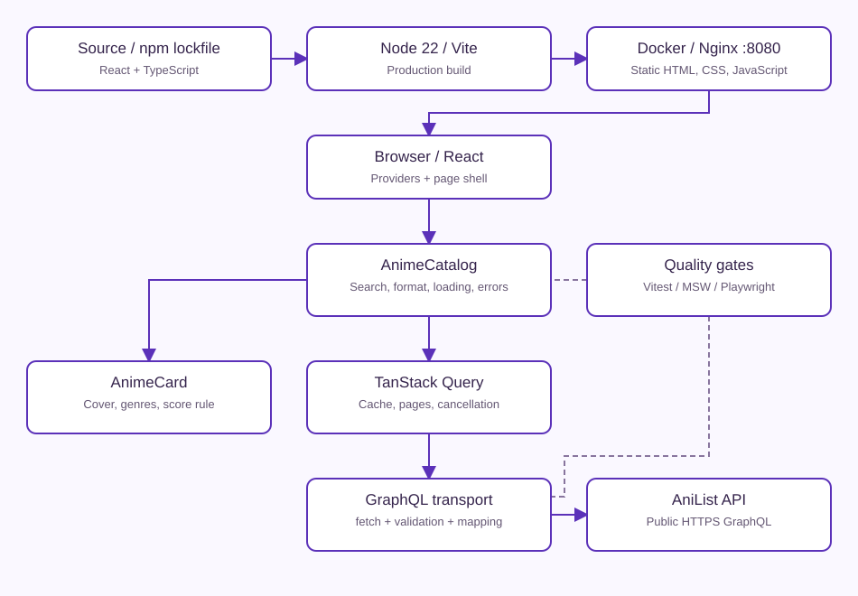

# Final architecture

Editable Mermaid source: [architecture.mmd](architecture.mmd). SVG is a standalone rendering of the same components and flows.

Nginx serves a static Vite build; requests to AniList originate in the browser, not in Nginx. There is no database, custom API, authentication or server-side state. React owns draft/submitted search and format. TanStack Query owns remote data, five-minute freshness, pages and cancellation. The transport checks HTTP/GraphQL errors and maps nullable fields into presentation models. Cards own only image-failure state; score classification is pure.

Switching criteria truncates the destination cache to its first page while preserving its freshness timestamp. Additional-page failures preserve current cards. 429 cooldown prevents new requests through the UI until Retry-After or the conservative fallback expires.

Docker build stage installs dependencies and compiles with Node 22; production contains only static output and unprivileged Nginx. Compose publishes 8080 with a read-only root filesystem and temporary writable /tmp. No secrets are required for public AniList queries.

Tests simulate the external boundary. The separate live API smoke confirms the real query contract without making CI availability-dependent.
